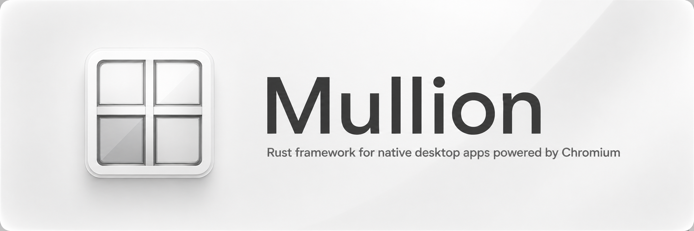

# Sabine

Sabine is a framework for desktop apps with web UIs and native windows. Write the interface with your web stack and the native side in Rust. Apps on the same machine use a managed Chromium runtime instead of each shipping a browser. Sabine supports Linux on Wayland, Windows, and Apple Silicon macOS.

It provides windows, palettes, trays, guest views, and a typed Rust–web bridge.

## How it works

An app combines a Rust executable, a web UI, and a `Sabine.toml` manifest. The UI can be packaged assets or a production URL. The manifest identifies the app and its web entry; Rust configures the window and registers native commands for the page to call.

When the app starts, Sabine checks the shared service and Chromium runtime. If they are missing, a native setup window prepares them before the app opens. The app then starts a native host process: Chromium renders the page offscreen, while Sabine handles the window, input, and GPU composition. The page calls registered Rust handlers through Sabine's bridge, which restricts commands to allowed origins. Embedded guest pages have no bridge access by default.

The shared service registers installed apps and manages runtime and app updates. It validates new runtimes before using them and keeps a previous working version for recovery. App releases and Sabine releases are separate, so an app can update without bundling Chromium again. [How Sabine works](https://sabine.rs/docs/concepts/architecture/) covers the process model, security boundaries, and platform details.

## Get started

Building an app requires Rust 1.98 or newer and Bun. The installed app does not need either tool.

```sh
cargo install --git https://github.com/Lantharos/Sabine --tag v0.69 sabine-cli
sabine new my-app
cd my-app
sabine dev
```

`sabine new my-notes --template notes` starts from a small notes app instead: a glass window that draws its own titlebar, with a typed command its page calls through generated bindings.

A Sabine app starts with `SabineWindow`; its web assets and identity live in `Sabine.toml`:

```rust
#![cfg_attr(target_os = "windows", windows_subsystem = "windows")]

fn main() {
    sabine::SabineWindow::main(|window| Ok(window.app().title("My App")));
}
```

```toml
[app]
id = "com.example.my-app"
name = "My App"
version = "1.0.0"

[web]
root = "ui"
dist = "ui/dist"
entry = "ui/dist/index.html"
dev_port = 5173
build = "bun run build"
```

Windows appear with their page's first frame. To show a loading screen while a slow page loads instead, add `splash = true` under `[window]`.

Generated projects already pin the matching Rust crate and TypeScript helper. For an existing project, add them yourself:

```toml
[dependencies]
sabine = { git = "https://github.com/Lantharos/Sabine", tag = "v0.69" }
specta = { version = "=2.0.0-rc.27", features = ["derive"] }

[profile.release]
lto = "fat"
codegen-units = 1
strip = true
```

The release profile keeps the app binary small: generated projects use it too.

```sh
bun add github:Lantharos/Sabine#v0.69
```

## Install and maintain

```sh
sabine install .                  # development launcher for this checkout
sabine install --bundle .         # production app independent of the checkout
sabine runtime install --system-wide            # Sabine and CEF for every user
sabine install --bundle --system-wide .         # this app for every user
sabine bundle .                   # release bundle for this machine
sabine update                     # CLI, shared components, and CEF
sabine update --force             # skip the release soak, keep integrity checks
sabine uninstall .                # remove this project's development install
sabine uninstall com.example.my-app --purge
sabine uninstall --system
```

Development runs use a `.dev` app identity and development environment files, keeping browser and app data separate from production. A production bundle uses its installed assets and production environment at build time; it does not need the source checkout. Uninstall keeps app data unless `--purge` is given. Run `sabine --help` for other commands and bundle targets.

`sabine -V` shows the CLI, installed service, and running daemon versions. If a launch fails, Sabine shows a native diagnostic window with an **Open logs** action.

## Documentation

The documentation lives at [sabine.rs/docs](https://sabine.rs/docs/), and its source is in [`website/`](website/):

- [Quick start](https://sabine.rs/docs/start/quick-start/)
- [Windows](https://sabine.rs/docs/windows/creating-windows/), [the bridge](https://sabine.rs/docs/bridge/commands/) and [desktop integration](https://sabine.rs/docs/desktop/tray/)
- [Shipping your app](https://sabine.rs/docs/distribution/bundling/)
- [JavaScript API](https://sabine.rs/docs/reference/javascript-api/) and [`Sabine.toml` reference](https://sabine.rs/docs/reference/manifest/)

## License

MIT or Apache-2.0. Chromium and CEF have their own licenses; see [third-party notices](THIRD_PARTY_NOTICES.md).
